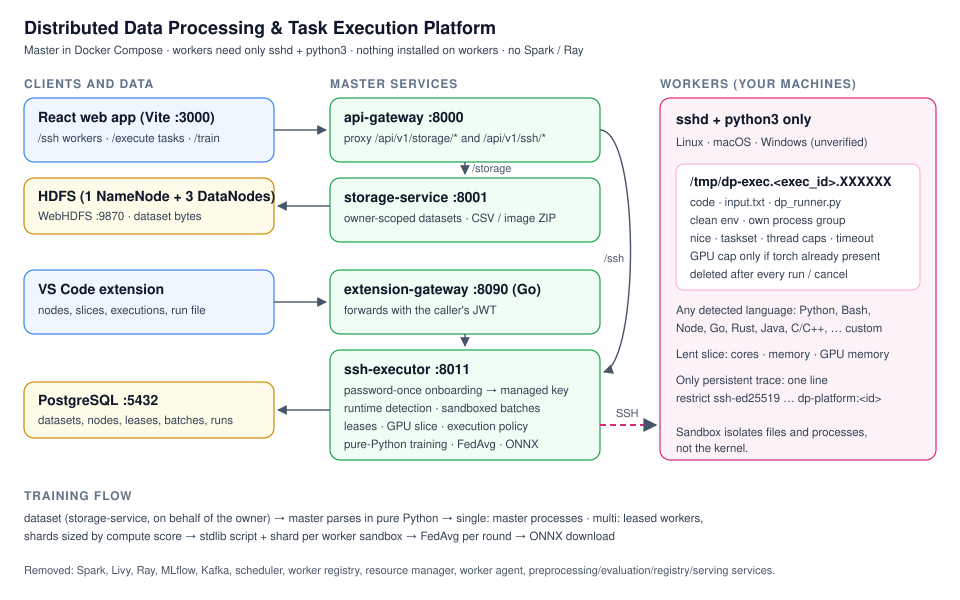

# Distributed Data Processing & Task Execution Platform

This repository contains a Docker Compose platform for dataset processing,
machine-learning workflows, and remote task execution. It includes a React
frontend, Python FastAPI services, an HDFS/Spark/Livy stack, an SSH executor,
a standalone worker-agent implementation, and a VS Code extension with a Go
gateway.

There are two distinct ways external compute appears in the codebase:

- `ssh-executor` connects directly to registered SSH provider hosts and runs
temporary Python tasks or federated-training shards.
- `worker/` is a separate agent/resource-request path using worker-registry,
resource-manager, scheduler, and the API Gateway WebSocket.

These paths are not interchangeable. The Compose SSH providers are manual test
sandboxes; they are not instances of the worker agent.

- [Architecture overview image](distributed-ai-platform/docs/architecture-overview.svg)
- [Full architecture reference](distributed-ai-platform/docs/architecture.md)
- [Connections, ports, and protocols](distributed-ai-platform/docs/connections.md)

## Architecture Overview



The React application and direct REST clients use the Python API Gateway on
port 8000. The VS Code extension targets a separate Go gateway on port 8090;
that gateway currently uses an in-memory store and is not connected to the
Python services. The current Compose file does not define the Go gateway.

## Components

### ML pipeline

| Stage | Components | Current path |
|---|---|---|
| Ingest | storage-service, HDFS, PostgreSQL | Dataset bytes are written to HDFS through WebHDFS; metadata is stored in PostgreSQL. |
| Preprocess | preprocessing-service, Livy, Spark | FastAPI submits PySpark batches through Livy; results are stored in HDFS. |
| Standard training | training-service, Livy, Spark, MLflow | PySpark training batches run on the Spark cluster and log runs/models to MLflow. |
| Evaluate | evaluation-service, storage-service, MLflow | Loads a model, downloads dataset bytes, and stores evaluation results. |
| Register and serve | registry-service, serving-service, MLflow | Registry aliases select models for online inference. |

### SSH task and training path

`services/ssh-executor` is the master-side SSH controller. It probes and
registers provider hosts, encrypts stored credentials, pins host keys, dispatches
scripts over SSH/SFTP, streams shard input through stdin, and cleans temporary
task files after execution.

For SSH-based training, `services/ssh-executor/training_orchestrator.py` reads
tabular datasets with Spark on the master. For image-derived datasets, it
downloads bytes from storage-service into a temporary local directory and reads
them with Ray Data, avoiding a direct Ray/libhdfs/JVM connection. It splits
rows, dispatches self-contained Python scripts generated in
`services/ssh-executor/ml_templates.py`, and aggregates shard weights on the
master. The `ssh-executor` dependencies, including compatible Ray Data,
PyArrow, NumPy, pandas, and setuptools pins, are in
`services/ssh-executor/pyproject.toml`.

Providers receive Python scripts and shard data; they do not run the master
Spark cluster or the master Ray Data reader. Linux/macOS/Windows command
adapters exist, but real Windows task execution has not been verified.

### Worker-agent path

The standalone `worker/` package registers an agent with worker-registry,
heartbeats capacity, and includes an approval UI. The automatic resource-request
push is incomplete: the configured `streaming-service:8007` is absent from
Compose, and the API Gateway worker-push helper is not called by the current
resource-manager flow. See the limitations in
[docs/architecture.md](distributed-ai-platform/docs/architecture.md).

## Manual SSH Test Sandboxes

The active `docker-compose.yml` defines two isolated test providers:

- `ssh-provider`
- `ssh-provider-2`

Both use the LinuxServer OpenSSH image and install Python 3 plus core utilities.
They are attached to the private `platform-net`; SSH port 2222 is not published
to the host. They are throwaway provider hosts, not the separate `worker/` agent
or the Spark workers. Their sample credentials are for local testing only.

## Frontend Training Updates

`frontend/src/pages/TrainPage.tsx` selects Spark for tabular/text datasets and
Ray for image datasets. Selecting a dataset preserves a compatible model
selection; the incompatible engine stays visible but disabled, and result cards
identify the model that ran. The SSH training-data download route in
`services/ssh-executor/routes.py` rebuilds data using the run's saved engine and
shard count.

## Current Verification

- The frontend production build passed after the Train Job selection fix.
- The SSH executor smoke test against `ssh-provider-2` passed remote Python
  execution, stdin transfer, and temporary-file cleanup.
- The Ray Data reader was exercised against the stored `cnn_image_data_test`
  dataset and returned 250 rows. A full multi-device Ray CNN run has not yet
  been verified end to end.
- A Spark run was manually observed completing across two shards.
- A real Windows provider is not yet verified. The last executor-container
  connection test to `10.10.18.73:22` timed out. At that check, the Windows
  worker's Wi-Fi profile was `Public`, while its OpenSSH firewall rule applied
  only to the `Private` profile; Docker/VPN reachability also needs validation.

## Technology Stack

| Area | Technology |
|---|---|
| Backend | Python 3.11, FastAPI, Pydantic v2, Uvicorn |
| Frontend | React 18, TypeScript, Vite, Tailwind CSS |
| Data processing | Apache Spark 3.5.0, Apache Livy, Ray 2.9.3 for SSH image-mode training |
| Storage | Apache Hadoop 3 HDFS, WebHDFS, PostgreSQL 15 |
| Model tracking | MLflow 2.14.3 |
| SSH execution | Paramiko, SFTP, per-OS command adapters |
| Editor integration | VS Code extension (TypeScript) and Go extension-gateway |
| Packaging | Docker Compose; Kubernetes manifests are scaffolding |

## Repository Layout

```text
.
|-- README.md
`-- distributed-ai-platform/
    |-- docker-compose.yml
    |-- config/
    |-- docs/
    |   |-- architecture.md
    |   |-- architecture-overview.svg
    |   `-- connections.md
    |-- frontend/                    React/Vite application
    |-- services/                    FastAPI services and Go gateway
    |-- shared/                      Shared Python library and schemas
    |-- worker/                      Standalone worker agent
    |-- distributed-compute-vscode/  VS Code extension
    |-- infrastructure/              HDFS/PostgreSQL and Kubernetes scaffold
    |-- livy/
    |-- scripts/
    `-- tests/
```

## Ports

| Component | Port | Notes |
|---|---:|---|
| React dev server | 3000 | Vite proxy to API Gateway |
| Python API Gateway | 8000 | Platform HTTP/WebSocket ingress |
| ML services | 8001-8006 | Storage through serving |
| Task services | 8008-8011 | Worker registry through SSH executor |
| PostgreSQL | 5432 | Platform and MLflow databases |
| HDFS | 9000, 9870 | RPC and WebHDFS/NameNode UI |
| Spark | 7077, 8080 | Master RPC and UI |
| Livy | 8998 | Spark batch submission |
| MLflow | 5000 | Tracking and model registry |
| SSH test providers | 2222 internal | Private Compose network only; not host-published |
| Go extension-gateway | 8090 | Run separately; not defined in current Compose |

Kafka/Zookeeper and Prometheus/Grafana/Loki configuration or scripts exist in
the repository, but those services are not defined in the current Compose file.
The resource-manager's `streaming-service:8007` target is absent as well.

## Quick Start

```bash
cd distributed-ai-platform
cp config/.env.example config/.env
# Edit config/.env and replace development secrets before non-local use.
docker compose up -d --build
make setup-hdfs
cd frontend
npm install
npm run dev
```

The Compose stack includes both manual SSH test providers. A real SSH provider
must run an SSH server, accept the configured credential, and be reachable from
the `ssh-executor` container. SSH access alone does not establish that Windows
task execution works.

## Tests

```bash
cd distributed-ai-platform
make test-unit
make test-integration
make lint

cd frontend
npm run build
```

The VS Code extension is built/tested separately in
`distributed-ai-platform/distributed-compute-vscode/` with `npm run compile`
and `npm test`. The Go gateway has its own `go test ./...` suite.

## Configuration and Security

Copy `config/.env.example` to `config/.env`. Set strong values for
`JWT_SECRET`, `SSH_CRED_KEY`, and other credentials before use beyond a local
test environment. There is no `/login` endpoint; development tokens are minted
out of band. SSH credentials are encrypted at rest, but `ssh-executor` runs
caller-supplied code on provider machines and must be treated as a privileged
remote-code-execution surface. Do not expose it to untrusted callers.

## Further Documentation

- [Architecture image](distributed-ai-platform/docs/architecture-overview.svg)
- [Detailed architecture](distributed-ai-platform/docs/architecture.md)
- [Connections and protocols](distributed-ai-platform/docs/connections.md)
- [VS Code extension](distributed-ai-platform/distributed-compute-vscode/README.md)

## License

The VS Code extension is under the [MIT License](distributed-ai-platform/distributed-compute-vscode/LICENSE); see individual components for their terms.
