# Distributed Compute: web dashboard

The dashboard lets you do everything from a browser: add worker machines, run
code on all of them in parallel, and train models. It is part of the platform
and starts with it; there is nothing extra to install.

**Open it at http://localhost:3001** after starting the platform (`make up`
in `distributed-ai-platform/`, or **Set Up Platform** in the VS Code
extension). It works in Chrome, Edge, Firefox and Safari, and on phones.

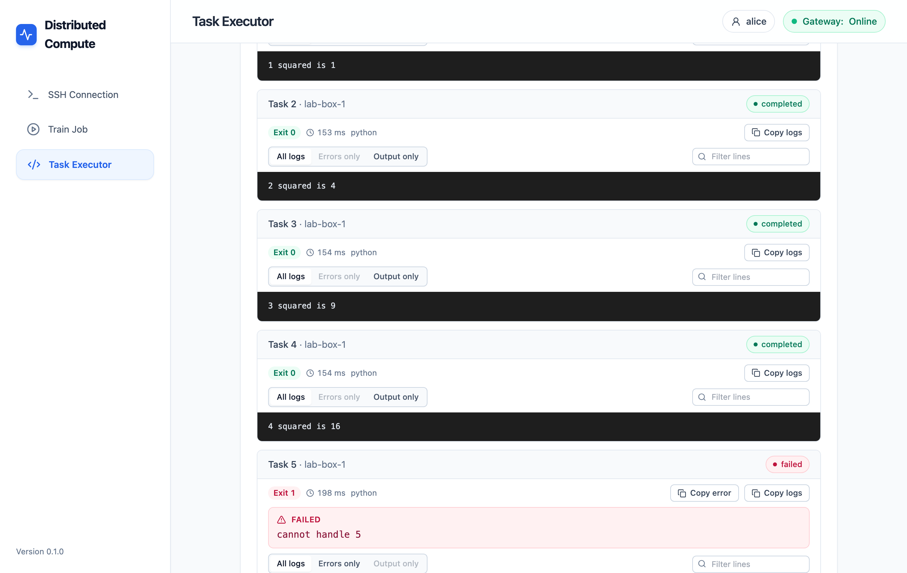

- [1. Sign in (only on shared servers)](#1-sign-in-only-on-shared-servers)
- [2. Add a worker](#2-add-a-worker)
- [3. Run code in parallel](#3-run-code-in-parallel)
- [4. Train a model](#4-train-a-model)
- [Use it well](#use-it-well) · [Troubleshooting](#troubleshooting) · [For developers](#for-developers)

The three pages are in the sidebar (on a phone, the bar at the top):
**SSH Connection** for workers, **Train Job** for training, **Task Executor**
for running code. At the top right you see who you are and whether the
platform answers (**Gateway: Online**).

## 1. Sign in (only on shared servers)

On your own computer you are the **Local user** and there is nothing to do.

On a server shared by a team, the administrator gives each person a token.
Click the account button at the top right, paste your token and click **Sign
in**. The page shows your name from then on; the same button signs you out.
Everyone sees only their own workers, runs and data.

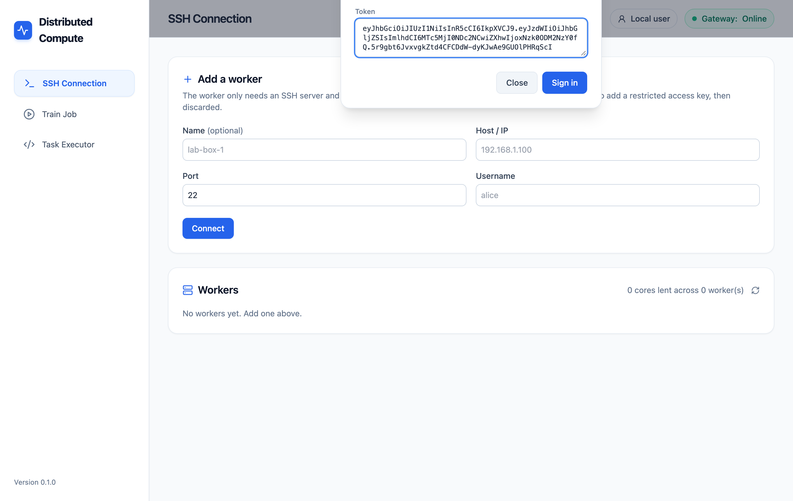

If your token expires, the sign-in window opens by itself and tells you so.

## 2. Add a worker

A worker is any computer you can reach over SSH that has Python 3: a lab
machine, a server, an old laptop, or this computer. Nothing is installed on
it. Use a dedicated, non-admin account there: your tasks run with its
permissions.

**Step 1: where is it?** On **SSH Connection**, fill in a name (optional), the
address, the SSH port (usually `22`) and the user name, then click
**Connect**.

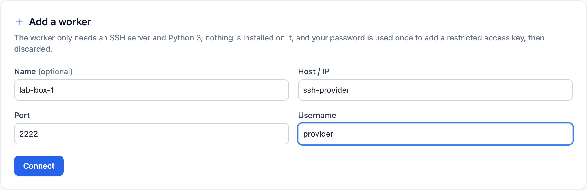

The platform runs in Docker, so use addresses as Docker sees them:

| Worker | Host / IP |
|---|---|
| This computer | `host.docker.internal` (turn on SSH / Remote Login first) |
| Another machine on your network | its IP address, e.g. `192.168.1.20` |
| The two test workers (`make up-dev`) | `ssh-provider` or `ssh-provider-2`, port `2222`, user `provider`, password `providerpass` |

Do not use `localhost`: inside Docker it means the platform's own container.

**Step 2: confirm it is your machine, and type the password once.** The
platform shows the machine's fingerprint before sending any password. If you
are unsure, compare it with `ssh-keygen -lf /etc/ssh/ssh_host_*_key.pub` on the
worker. The password is used once to add a restricted key and is never
stored. Click **Confirm & Add**.

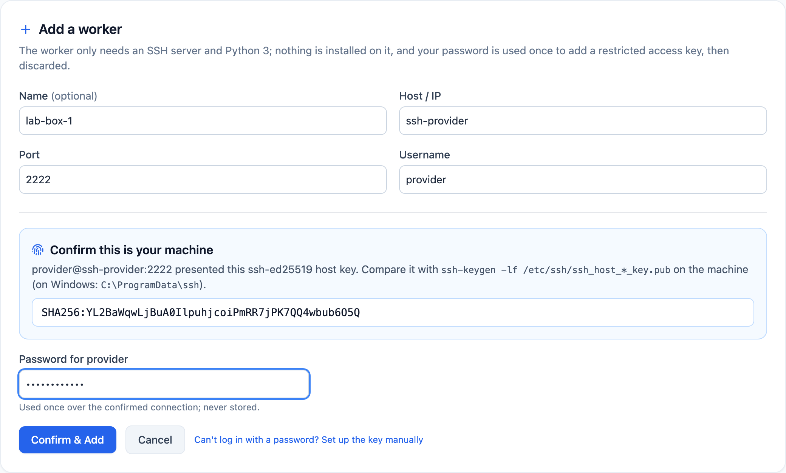

If the machine does not accept passwords, click **Can't log in with a
password? Set up the key manually**: you get one command to run on the
worker, then click **I ran it — verify**.

**Step 3: decide how much to lend.** The platform shows what it found: cores,
memory, GPUs, the operating system and the languages installed. Half the
machine is proposed; move the sliders, then click **Register**.

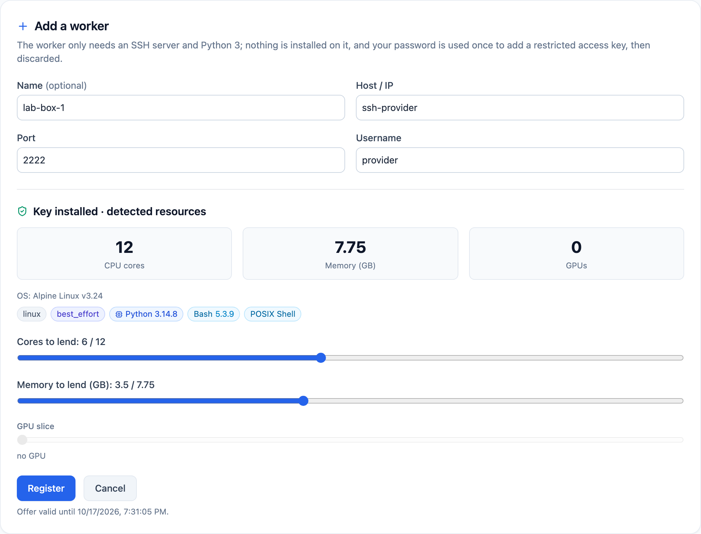

**Your workers.** Each row shows the worker's address, slice, health and
languages. The icon buttons on the right (hover one to see its name), from
left to right:

| Button | What it does |
|---|---|
| Health check | Checks that the worker answers over SSH. |
| Re-detect resources and languages | Finds newly installed languages and hardware. |
| Rotate access key | Replaces the platform's key on the worker with a new one. |
| Drain worker / Resume worker | Drain: running work finishes, no new work is sent. Resume: back to normal. |
| Edit name and allocation | Rename it or change the cores, memory and GPU it lends. |
| Remove worker | Forgets the worker and deletes the platform's key from it. |

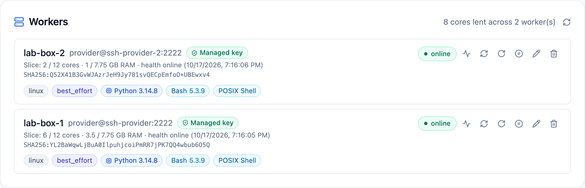

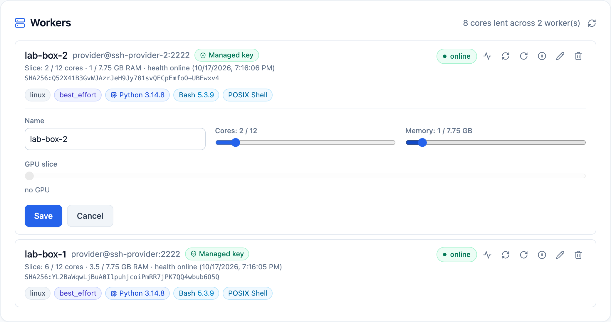

## 3. Run code in parallel

Open **Task Executor**.

**Choose the language.** Only languages found on your workers can be chosen;
greyed-out ones are not installed anywhere. **Custom command** runs any other
language: give the file name (e.g. `main.zig`) and the command (e.g. `zig run
{file}`). Below, pick which workers to use, or leave them all unselected to use
every eligible one.

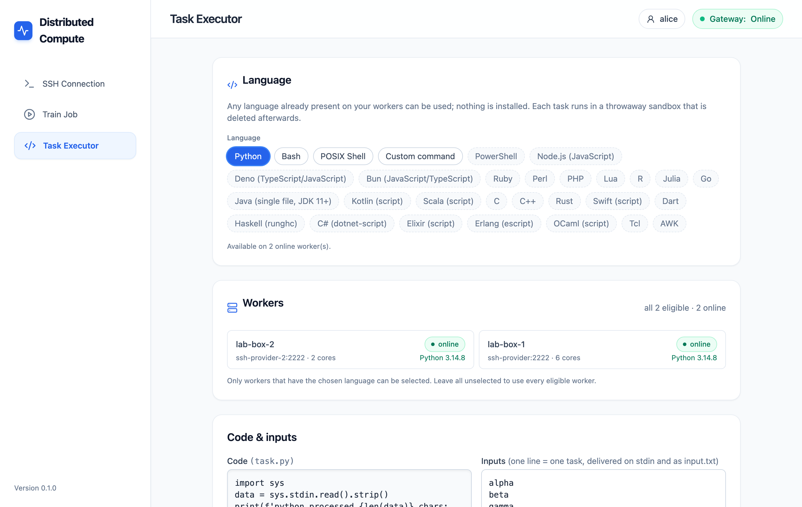

**Write the code and the inputs.** Each line in **Inputs** becomes one task.
The task receives its line on standard input (and in a file `input.txt`), so
`input()` in Python or `read` in Bash gets it. Set the cores per task, the
priority (**Safe background** is gentlest on the worker) and, if you like, a
timeout. Click **Run in parallel**.

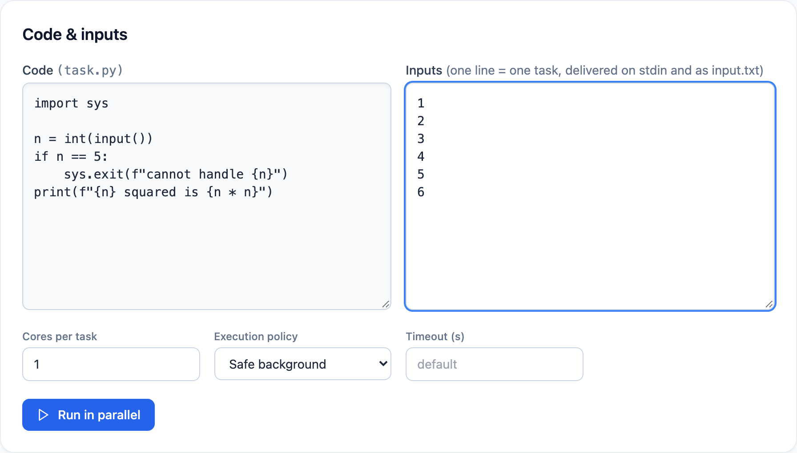

**Watch the results.** Every task appears with its worker, status, exit code
and run time, and its output as it arrives. **Errors only** and **Output only**
filter the log; the search box filters lines; **Copy logs** copies it.


When a task fails, its error is pulled out and shown at the top in red, with
**Copy error**: no need to scroll through the log.

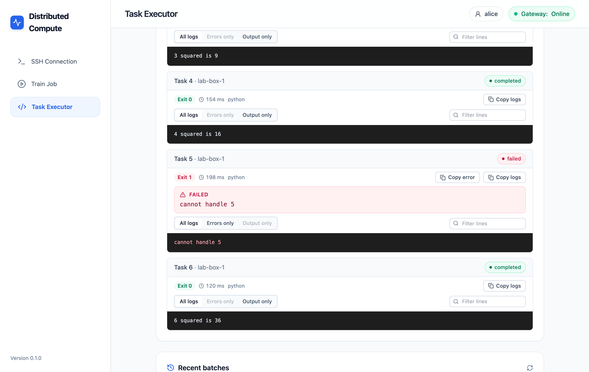

**Retry and re-run.** When some tasks failed, **Retry 1 failed** runs just
those inputs again. **Run again** repeats the whole run. **Cancel** stops a run
that is still going. Your recent runs are listed at the bottom of the page;
click one to see it again.

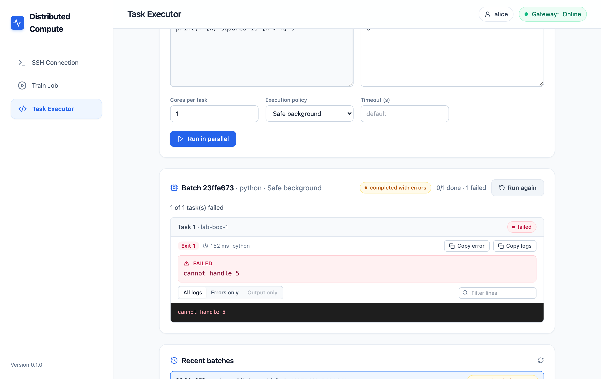

## 4. Train a model

Open **Train Job**.

**Engine and model.** **Pure Python** is always available. **Apache Spark +
Ray** is optional and adds every Spark MLlib model; the box says how to turn it
on if it is not installed. Choose a model: logistic regression (yes/no
targets), linear regression (numbers), a small CNN for images, or **Your own
model** (paste or load a `model.py` with a `train()` function, using any
library your workers have). Then choose where to train: on your workers, or on
the master only.

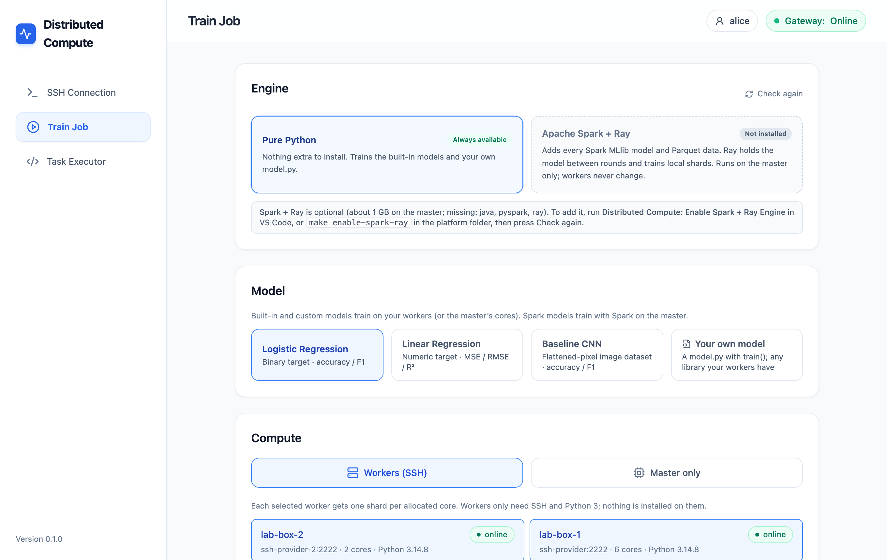

**Dataset.** Upload a CSV or Parquet file (or a ZIP of images in one folder per
class), or pick one uploaded before. Choose the **Target column** (what to
predict); the other numeric columns are used as features, and you can change
which.

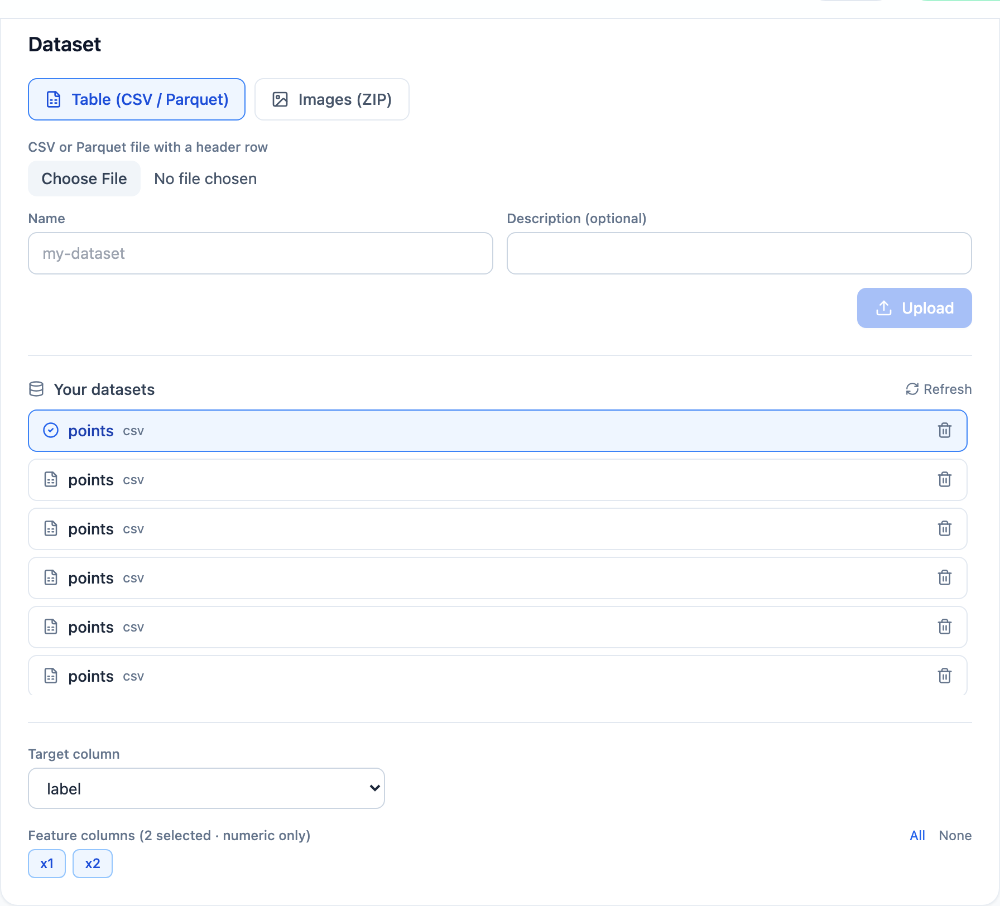

**Start.** Check the learning rate, epochs and rounds, then click **Start
Training**.

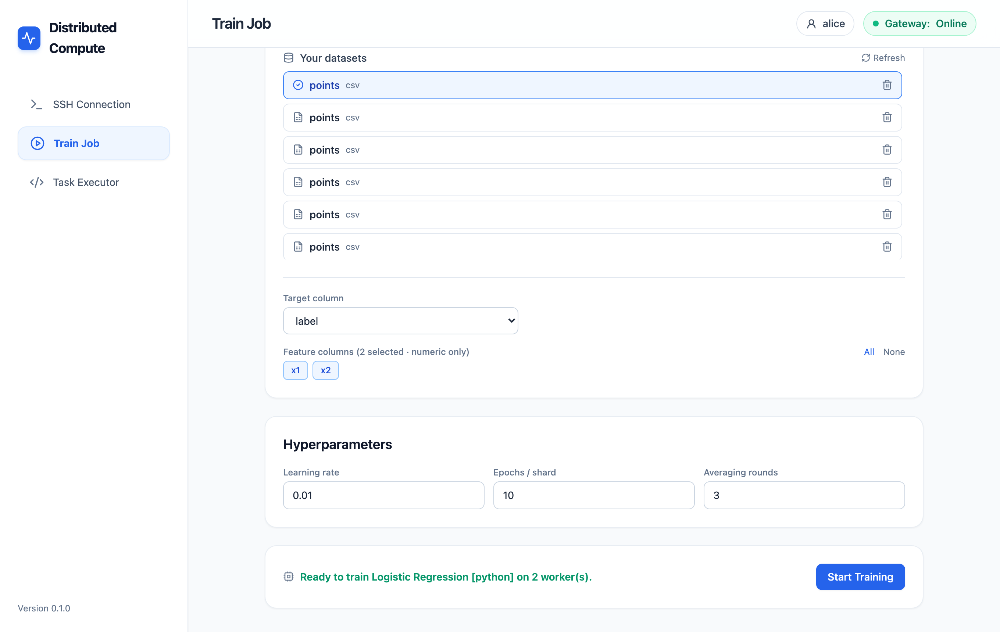

**Result.** You see the metrics (accuracy, precision, recall and F1, or the
error for regression) and how the data was split across workers. Download the
model (ONNX for built-in models), the training data, or start a new training.

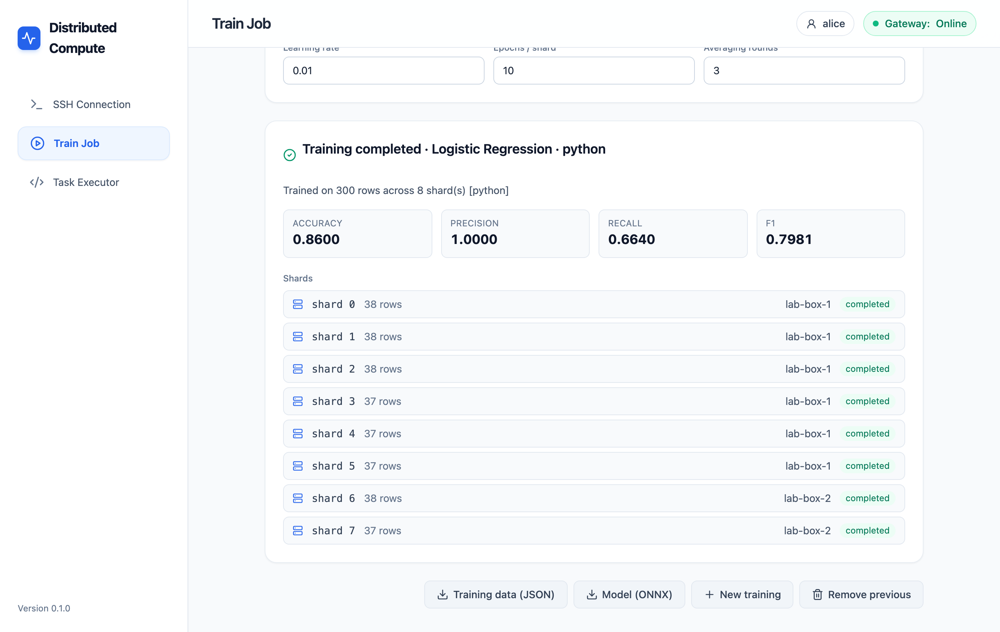

## On a phone

Everything works on a phone or tablet; the menu moves to the top.

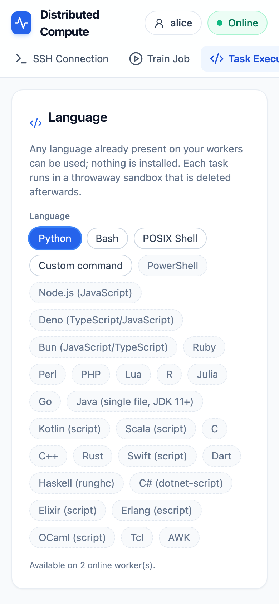

## Use it well

- **Many small tasks beat a few big ones.** One task per file, per parameter or
  per chunk of data keeps every core busy. Tasks beyond the free cores wait and
  start as soon as a core is free.
- **One core per task** unless your code uses several threads.
- **Print your results.** Each task runs in a temporary folder that is deleted
  afterwards; what you print is kept.
- **Retry only what failed** instead of re-running everything.
- **Drain a worker** before restarting or updating it, then **Resume**.
- **On a computer you also use,** lend half of it and keep **Safe background**.

## Troubleshooting

| What you see | What to do |
|---|---|
| **Gateway: Offline** | The platform is not running: `make up` in `distributed-ai-platform/`, or **Set Up Platform** in VS Code. |
| The sign-in window keeps opening | Your token is wrong or expired; ask for a new one. |
| "Wrong password" when adding a worker | Check the password and user, or use **Set up the key manually**. |
| "Could not reach" a worker | Check the address (not `localhost`), that the machine is on and that SSH runs on that port. |
| A language is greyed out | It is not installed on any online worker. Install it there, then click Re-detect on the worker. |
| An upload fails just after starting the platform | Storage needs about half a minute after a start; try again. |

## For developers

```bash
npm install
npm run dev        # http://localhost:3000, with hot reload (platform running)
npm test           # unit tests
npm run lint
npm run build
```

Browser tests run against the real platform with the test workers
(`make up-dev`), as three users on three ports, in Chromium, Firefox, WebKit
and on Android and iPhone screens:

```bash
npm run e2e:serve          # the production image on ports 4101-4103
npm run test:e2e
npm run docs:screenshots   # re-creates the images in this README
npm run e2e:stop
```
